---
sources:
- resource: Matlab2/RESUMO_CONTROLE_CLMULTI.md
  id: resumo
  title: Matlab2/RESUMO_CONTROLE_CLMULTI.md:1-57
- resource: matlab/script_controle_lqi_luenberger_run.m
  id: lqi-run
  title: matlab/script_controle_lqi_luenberger_run.m:1-100
- id: bloco-2p
  resource: matlab/Bloco_Hidraulico_2P.m
  title: matlab/Bloco_Hidraulico_2P.m:1-65
- title: matlab/LQI_Observer_omega.m:1-80
  id: lqi-obs
  resource: matlab/LQI_Observer_omega.m
tags:
- control-theory
- lqr
- lqi
- luenberger
- clmulti
- plid
status: stable
type: Architecture
generated_by: vio-wiki/deepseek-reasoner
description: 'Estratégias de controle: controle indireto por posição (CLMULTI/LQR/Luenberger)
  versus controle direto LQI em pressão (2P).'
title: Control Strategy
generated:
  by: vio-companion/12.2.2
  at: '2026-10-19T18:42:56Z'
---

# Control Strategy

A regulação de pressão hidráulica em atuadores de frenagem para veículos autônomos e funções ADAS apresenta fortes desafios de não linearidade, saturação de atuadores e histerese elasto-hidráulica.[^resumo] No escopo deste projeto, duas estratégias principais foram desenvolvidas e analisadas: o **Controle Indireto de Pressão por Posição** (validado experimentalmente) e o **Controle Direto Ótimo LQI de Pressão** (avaliado em simulação).

```mermaid
flowchart TD
    subgraph Controle_Indireto ["Estratégia 1: Controle Indireto por Posição (Bancada Real)"]
        Pref["P_ref (bar / psi)"] --> LUT["Tabela Inversa: x_ref = g⁻¹(P_ref)"]
        LUT --> ErrPos["e_pos = x_ref - pos_real"]
        ErrPos --> IntPos["Integrador Digital: v[n+1] = v[n] + e_pos"]
        ObsLuen["Observador Luenberger: x̂[n+1] = Φ·x̂ + Γ·u + L·(y - C·x̂)"]
        ObsLuen --> StateFeed["u = -K·x̂ + Ki·v"]
        IntPos --> StateFeed
        StateFeed --> PWM_LAC["PWM do Motor LAC"]
        PWM_LAC --> LAC_Planta["Atuador Linear (LAC)"]
        LAC_Planta --> Pw_Real["Pressão Pw Resultante"]
    end

    subgraph Controle_Direto ["Estratégia 2: Controle LQI Direto de Pressão (Simulação 2P)"]
        Pref_D["P_ref"] --> ErrP["e_p = P_ref - P_w"]
        ErrP --> IntLQI["xi_cand = xi + e_p * Ts"]
        Obs2P["Observador Discreto: x̂ = Ad·x̂ + Bd·u + Ld·(Pw - Cd·x̂)"]
        Obs2P --> LQI_Law["omega_unsat = -Kx·x̂ - Ki·xi"]
        IntLQI --> LQI_Law
        LQI_Law --> AntiWindup["Anti-windup Condicional & Saturação"]
        AntiWindup --> OmegaPump["Comando ω_p (Bomba Hidráulica)"]
    end
```

## 1. Controle Indireto de Pressão via Posição (CLMULTI)

Durante o desenvolvimento experimental em bancada física, verificou-se uma regra de projeto mandatória:[^resumo]
> **PRESSÃO NÃO FECHA A MALHA DE CONTROLE**: O valor medido de pressão na pinça ($P_w$) **não** é realimentado diretamente na lei de controle. Ele é utilizado estritamente para logging de telemetria, diagnóstico de segurança e identificação da planta.

### Justificativa Física e de Engenharia
- A malha fechada direta em pressão gera comutações excessivas e ciclos limite entre as válvulas solenoides de Apply e Release, degradando a vida útil e gerando instabilidade por chattering.[^resumo]
- Em contrapartida, o deslocamento linear do pistão do atuador ($x$) é uma grandeza continuamente mensurável e suave.
- A pressão de roda é função unívoca (embora com histerese) do deslocamento: $P_w = g(x)$.

### Formulação do Servossistema Digital (Apostila PTC5611)
A malha de posição é implementada através de um servossistema aumentado com integrador e observador de estados de Luenberger:[^resumo]
1. **Dinâmica do Integrador**:
   $$v[n+1] = v[n] + (x_{ref} - y_{pos}[n])$$
2. **Observador de Luenberger**:
   $$\hat{x}[n+1] = \Phi \hat{x}[n] + \Gamma u[n] + L (y_{pos}[n] - C \hat{x}[n])$$
3. **Lei de Controle**:
   $$u[n] = -K \hat{x}[n] + K_i v[n]$$
4. **Calibração de Referência**: A referência de posição $x_{ref} = g^{-1}(P_{ref})$ é obtida por uma LUT (*Look-Up Table*) calibrada pelos ensaios em degraus [PLID](../modules/matlab2-bench-tests.md).[^resumo]

---

## 2. Controle LQI Direto de Pressão (Simulação 2P)

No domínio de simulação detalhada em [Matlab Simulation & Synthesis](../modules/matlab-simulation.md), o sistema hidráulico foi sintetizado com uma abordagem de controle ótimo multivariável.[^lqi-run]

### Modelo Linearizado e Sistema Aumentado
A planta possui dois estados hidráulicos $x = [P_{sup}, P_w]^T$, sendo a rotação da bomba $\omega_p$ o sinal de controle ($u$) e $P_w$ a saída medida ($y$).[^bloco-2p]
Para garantir erro nulo em regime permanente, expande-se o espaço de estados com um estado integrador:
$$x_{aug}[n+1] = \begin{bmatrix} A_d & 0 \\ -C_d T_s & 1 \end{bmatrix} x_{aug}[n] + \begin{bmatrix} B_d \\ 0 \end{bmatrix} u[n]$$

O ganho ótimo $K_{aug} = [K_x \;\; K_i]$ é computado via `dlqr` minimizando a função custo:[^lqi-run]
$$J = \sum_{n=0}^{\infty} \left( x_{aug}^T Q_{aug} x_{aug} + u^T R u \right)$$
com matrizes de ponderação calibradas: $Q_{aug} = \text{diag}([10^{-12}, 10^{-10}, 10^4])$ e $R = 10^{-7}$.[^lqi-run]

### Anti-Windup e Saturação Física
Em sistemas não reversíveis ($\omega_p \ge 0$) sujeitos a limites operacionais de pressão de suprimento ($P_{sup,max}$), o bloco [LQI_Observer_omega.m](../modules/matlab-simulation.md) implementa integração condicional (anti-windup por congelamento de integrador) para prevenir o *runaway* de pressão.[^lqi-obs]

## Conexões
- Para detalhes dos blocos de simulação Simulink/MATLAB, consulte [Matlab Simulation & Synthesis](../modules/matlab-simulation.md).
- Para os detalhes dos ensaios CLMULTI e PLID, veja [Bench Testing & Identification](../modules/matlab2-bench-tests.md).
- Para a análise de robustez das matrizes de ganho, veja [Experimental Validation & Robustness](experimental-validation.md).

[^resumo]: Matlab2/RESUMO_CONTROLE_CLMULTI.md:1-57
[^lqi-run]: matlab/script_controle_lqi_luenberger_run.m:1-100
[^bloco-2p]: matlab/Bloco_Hidraulico_2P.m:1-65
[^lqi-obs]: matlab/LQI_Observer_omega.m:1-80
