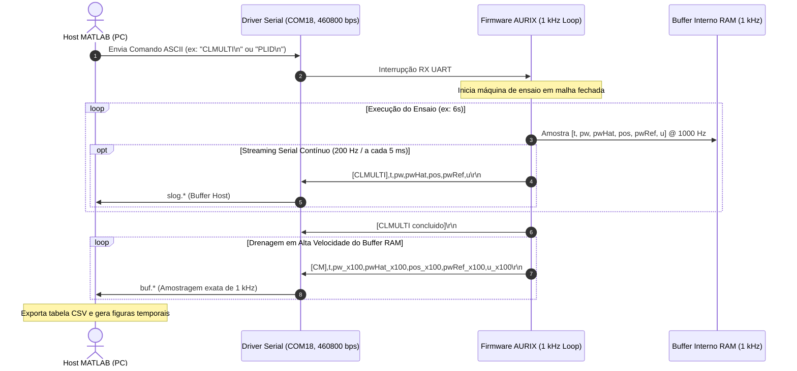

# Data Flow & Telemetry

A integridade temporal da telemetria e o controle determinístico em bancada dependem de uma arquitetura de troca de mensagens serial assíncrona robusta entre a estação host MATLAB e a placa eletrônica automotiva Infineon AURIX.[^clmulti]



## Modos de Operação e Protocolos

A comunicação ocorre via UART com taxa de transmissão de **460.800 bps** e terminação `CR/LF`.[^clmulti] Três estruturas principais de pacotes são manipuladas pelos scripts de controle e pelos blocos [Serial Communication & Codec](../modules/serial-interface.md):

### 1. Protocolo de Ensaio CLMULTI
- **Streaming contínuo (tempo real, taxa ~200 Hz)**:[^clmulti]
  ```text
  [CLMULTI],t_ms,pw,pwHat,pos,pwRef,u
  ```
  Permite o acompanhamento da telemetria em tempo de execução na GUI do MATLAB.
- **Buffer de Alta Fidelidade (1 kHz pós-ensaio)**:[^clmulti]
  ```text
  [CM],t_ms,pw_x100,pwHat_x100,pos_x100,pwRef_x100,u_x100
  ```
  Os valores com sufixo `_x100` são inteiros escalados para economizar largura de banda na UART, divididos por 100 no MATLAB para recuperar o valor real em ponto flutuante ($P_w$ em psi, posição em mm e $u$ em $\%$ de PWM).

### 2. Protocolo de Identificação PLID
- Utilizado para caracterização da relação $P_w = g(x)$:[^plid]
  - Streaming: `[PLID],t_ms,step,phase,pw,pos`
  - Buffer 1 kHz: `[PB],t_ms,step,phase,pw_x100,pos_x100`

### 3. Protocolos de Controle Interativo em Tempo Real (`ECHO` e `LIVE`)
Codificados pelo [BrakeSerialEncoder](../modules/serial-interface.md) e decodificados pelo [BrakeSerialDecoder](../modules/serial-interface.md):[^encoder][^decoder]
- **Modo ECHO**:
  - Comando enviado: `[ECHO]<omega,u_in,u_out>\n`
  - Resposta recebida: `[ECHO],omega,u_in,u_out,pw_psi,pos_mm,status\r\n`
- **Modo LIVE**:
  - Comando enviado: `OMEGA_P=%.2f,U_IN=%u,U_OUT=%u\n`
  - Resposta recebida: `[LIVE],omega,u_in,u_out,pw_psi,pos_mm,status\r\n`

## Persistência de Dados e Rastreabilidade
Cada execução de ensaio serial gera automaticamente arquivos CSV versionados na pasta `Matlab2/dados/` no formato `ensaio_<tipo>_buf1khz_YYYYMMDD_HHMMSS.csv`.[^clmulti] Esses registros formam a base empírica consumida pelas rotinas de identificação paramétrica ([identify_tau_gain_from_csv.m](../modules/matlab2-bench-tests.md)).

## Conexões
- Para detalhes dos blocos decodificadores/codificadores Simulink, consulte [Serial Communication & Codec](../modules/serial-interface.md).
- Para a rotina de ensaios e análise dos CSVs, veja [Bench Testing & Identification](../modules/matlab2-bench-tests.md).
- Para a arquitetura de controle associada, consulte [Control Strategy](control-strategy.md).

[^clmulti]: Matlab2/ensaio_clmulti_serial.m:1-100
[^plid]: Matlab2/ensaio_plid_serial.m:1-100
[^encoder]: Matlab2/BrakeSerialEncoder.m:1-47
[^decoder]: Matlab2/BrakeSerialDecoder.m:1-64
