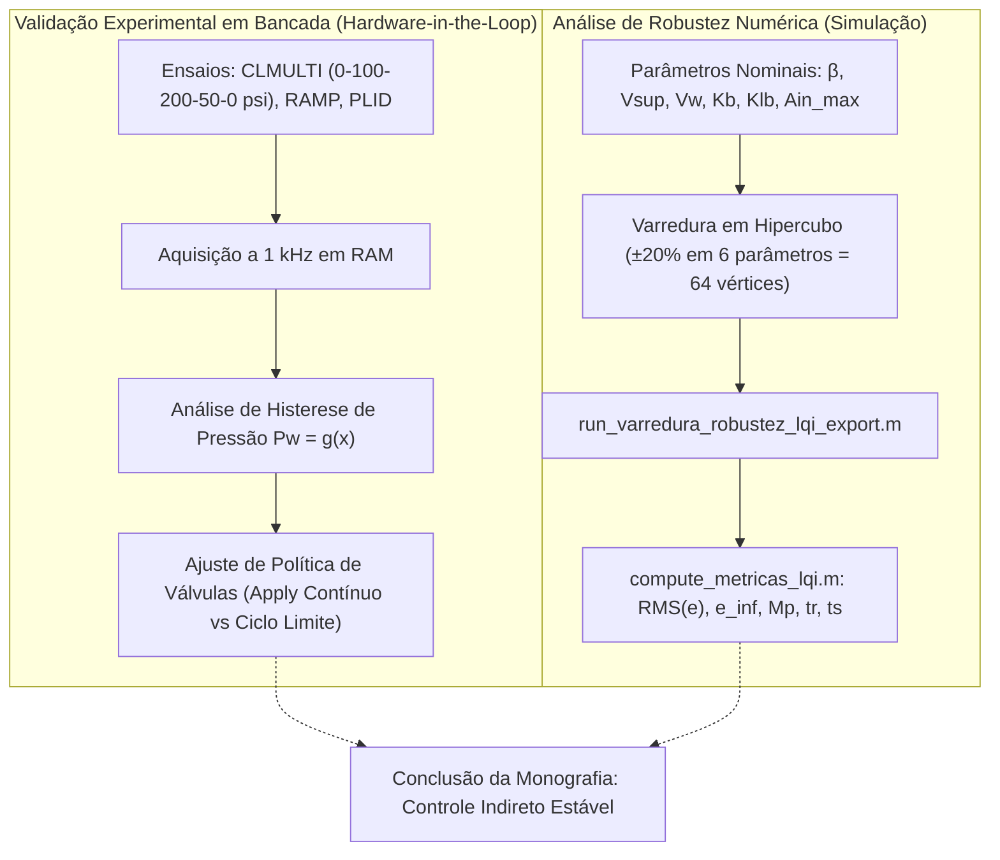

---
sources:
- id: robustez
  title: matlab/run_varredura_robustez_lqi_export.m:1-100
  resource: matlab/run_varredura_robustez_lqi_export.m
- id: resumo
  title: Matlab2/RESUMO_CONTROLE_CLMULTI.md:1-57
  resource: Matlab2/RESUMO_CONTROLE_CLMULTI.md
type: Architecture
status: stable
title: Experimental Validation & Robustness
description: Metodologia de validação experimental, identificação paramétrica (tau
  e K_vel) e robustez paramétrica.
generated_by: vio-wiki/deepseek-reasoner
tags:
- validation
- robustness
- monte-carlo
- hysteresis
- limit-cycle
- bench-test
generated:
  by: vio-companion/12.2.2
  at: '2026-10-19T18:44:20Z'
---

# Experimental Validation & Robustness

A validação de um sistema crítico de frenagem automotiva para aplicações ADAS requer a comprovação de estabilidade, precisão de seguimento de trajetória e robustez paramétrica frente ao envelhecimento dos componentes, variações de temperatura e dispersão de fabricação.[^robustez][^resumo]

## 1. Desafios Experimentais e Mitigações em Bancada

Durante a realização dos ensaios em malha fechada no atuador físico ([CLMULTI](../modules/matlab2-bench-tests.md)), foram identificados fenômenos cruciais detalhados no relatório técnico do projeto:[^resumo]

### O Fenômeno do Ciclo Limite nas Válvulas
- **Problema**: Inicialmente, a lógica de chaveamento das válvulas utilizava bandas de posição excessivamente estreitas para comutar entre os modos `Apply` e `Hold`.[^resumo] Isso gerou ciclos limite severos (comutação em alta frequência), provocando recuos involuntários do pistão e sobrelevação (*overshoot*) de pressão.[^resumo]
- **Solução de Arquitetura**: Modificou-se a estratégia para manter o solenoide de **Apply contínuo** enquanto a pressão de referência for positiva ($P_{ref} > 0$), permitindo que a modulação por PWM do motor do LAC controle suavemente a posição linear. O solenoide de **Release** é acionado apenas quando a referência é nula ($P_{ref} = 0$) ou em descidas acentuadas de pressão.[^resumo]

### Histerese Não Linear $P_w = g(x)$
- A curva de pressão em função do deslocamento do pistão exibe histerese acentuada decorrente da deformação elástica das vedações hidráulicas e da linha de freio.[^resumo]
- Como consequência, a posição durante o cruzamento da pressão no ensaio dinâmico difere da posição necessária para sustentação estática (*hold*). A calibração da tabela inversa $g^{-1}(P_{ref})$ foi refinada especificamente na região de transição para evitar subpressurização no retorno aos patamares mais baixos (ex: $200 \rightarrow 50\,\text{psi}$).[^resumo]

---

## 2. Varredura de Robustez Paramétrica (`run_varredura_robustez_lqi_export.m`)

Para certificar que a lei de controle ótimo linear quadrático (LQI) projetada é insensível a desvios operacionais dos parâmetros físicos do bloco hidráulico, implementou-se uma rotina automatizada de teste em hipercubo paramétrico.[^robustez]

### Parâmetros Analisados ($\pm 20\%$ de Variação)
O script submete o modelo Simulink à variação extrema nos seguintes parâmetros constitutivos:[^robustez]
1. $\beta$: Módulo de compressibilidade volumétrica efetivo do fluido de freio ($1.5 \times 10^9\,\text{Pa}$).
2. $V_{sup}$: Volume da câmara de suprimento de pressão ($6.0 \times 10^{-5}\,\text{m}^3$).
3. $V_w$: Volume efetivo do cilindro da roda / pinça ($1.0 \times 10^{-5}\,\text{m}^3$).
4. $K_b$: Deslocamento volumétrico por rotação da bomba hidráulica.
5. $K_{lb}$: Coeficiente de vazamento interno por retorno de pressão.
6. $A_{in,max}$: Área máxima efetiva do orifício da válvula de admissão ($3.0 \times 10^{-7}\,\text{m}^2$).

### Síntese de Pior Caso
Com $2^6 = 64$ combinações de cantos no espaço paramétrico mais o caso nominal, a rotina extrai as métricas de desempenho via `compute_metricas_lqi.m` e gera diretamente a tabela LaTeX `elementos-textuais/tabelas/metricas_robustez.tex`:[^robustez]
- Erro médio quadrático: $\text{RMS}(e)$
- Erro em regime estacionário: $e_\infty$
- Tempo de subida de 10% a 90%: $t_r$
- Tempo de acomodação a 2%: $t_s$
- Máximo sobre-sinal percentual: $M_p$

Os resultados numéricos comprovam que a ação integral combinada ao observador de Luenberger mantém a estabilidade estrita e erro assintótico residual contido dentro dos requisitos de segurança funcional para sistemas ADAS.[^robustez]

## Conexões
- A teoria e formulação matemática estão em [Control Strategy](control-strategy.md).
- O código da varredura paramétrica está detalhado em [Matlab Simulation & Synthesis](../modules/matlab-simulation.md).
- Os ensaios de bancada correspondentes estão documentados em [Bench Testing & Identification](../modules/matlab2-bench-tests.md).

[^robustez]: matlab/run_varredura_robustez_lqi_export.m:1-100
[^resumo]: Matlab2/RESUMO_CONTROLE_CLMULTI.md:1-57
