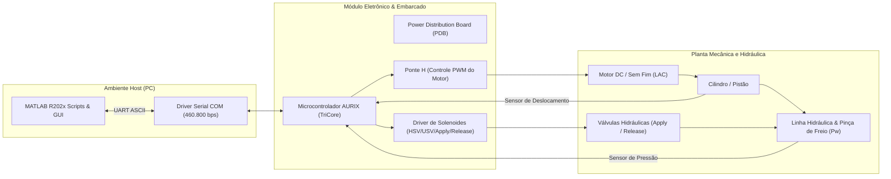

---
tags:
- architecture
- aurix
- lac
- hydraulics
- hardware
type: Architecture
status: stable
sources:
- id: resumo
  resource: Matlab2/RESUMO_CONTROLE_CLMULTI.md
  title: Matlab2/RESUMO_CONTROLE_CLMULTI.md:1-57
- id: clmulti
  title: Matlab2/ensaio_clmulti_serial.m:1-100
  resource: Matlab2/ensaio_clmulti_serial.m
- resource: Matlab2/BrakeSerialDecoder.m
  id: serial-codec
  title: Matlab2/BrakeSerialDecoder.m:1-64
- title: Matlab2/identify_tau_gain_from_csv.m:1-120
  resource: Matlab2/identify_tau_gain_from_csv.m
  id: tau-id
- resource: matlab/Bloco_Hidraulico_2P.m
  title: matlab/Bloco_Hidraulico_2P.m:1-65
  id: bloco-2p
generated_by: vio-wiki/deepseek-reasoner
description: 'Arquitetura do sistema do módulo de freio: hardware AURIX, atuador linear
  (LAC), bloco hidráulico 2P e interface serial.'
title: System Architecture
generated:
  by: vio-companion/12.2.2
  at: '2026-10-19T18:42:37Z'
---

# System Architecture

A arquitetura do sistema do módulo de freio compreende a integração entre o hardware eletrônico automotivo, atuadores eletromecânicos e hidráulicos, e o ambiente de controle em tempo real.[^resumo]

## Componentes Principais

### 1. Unidade de Processamento (AURIX TC2xx/TC3xx)
O firmware embarcado no microcontrolador automotivo Infineon AURIX executa loops em alta frequência (1 kHz no buffer interno e 200 Hz para streaming serial contínuo).[^clmulti] O firmware é responsável por:
- Leitura analógica dos sensores de pressão ($P_w$) e sensores de deslocamento linear do pistão ($pos$).[^serial-codec]
- Acionamento das pontes de potência (PWM para motor do atuador linear LAC).[^tau-id]
- Disparo e chaveamento dos solenoides das válvulas hidráulicas de admissão e descarga.[^resumo]
- Máquina de estados dos ensaios de identificação e segurança (`HOMING`, `APPLY`, `HOLD`, `RELEASE`).

### 2. Atuador Mecânico Linear (LAC - Linear Actuator)
O atuador converte a rotação do motor em avanço linear do pistão hidráulico. O sistema apresenta uma constante de tempo mecânica $\tau$ e um ganho de velocidade em malha aberta $K_{vel}$ (expresso em $\text{mm/s}$ por $\%$ de PWM), os quais são identificados a partir das curvas transitórias.[^tau-id]

### 3. Circuito Hidráulico de Duas Pressões (2P)
Conforme modelado em [Matlab Simulation & Synthesis](../modules/matlab-simulation.md), o sistema físico divide-se em dois compartimentos de pressão:[^bloco-2p]
- **Pressão de Suprimento ($P_{sup}$)**: gerada pela rotação da bomba de deslocamento positivo $\omega_p$.
- **Pressão da Roda/Pinça ($P_w$)**: resultante da modulação de abertura das válvulas solenoides de entrada ($u_{in}$) e saída ($u_{out}$).

### 4. Interface Serial e Placa de Distribuição de Potência (PDB)
A alimentação das bobinas das válvulas e dos estágios de potência do motor é provida pela placa PDB (*Power Distribution Board*). A comunicação com a bancada no PC é efetuada por UART rápida a 460.800 bps, garantindo latência inferior a $2\,\text{ms}$ por quadro de telemetria.[^clmulti]

## Conexões e Dependências
- Para os detalhes do protocolo de pacotes e tráfego de dados, consulte [Data Flow & Telemetry](data-flow.md).
- Para a dinâmica de controle implementada no microcontrolador e no Simulink, veja [Control Strategy](control-strategy.md).
- Para os scripts de aquisição em bancada, consulte [Bench Testing & Identification](../modules/matlab2-bench-tests.md).

[^resumo]: Matlab2/RESUMO_CONTROLE_CLMULTI.md:1-57
[^clmulti]: Matlab2/ensaio_clmulti_serial.m:1-100
[^serial-codec]: Matlab2/BrakeSerialDecoder.m:1-64
[^tau-id]: Matlab2/identify_tau_gain_from_csv.m:1-120
[^bloco-2p]: matlab/Bloco_Hidraulico_2P.m:1-65
