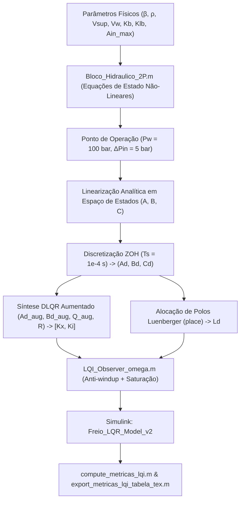

# Matlab Simulation & Synthesis

O módulo `matlab/` concentra os modelos matemáticos contínuos, rotinas de linearização analítica, síntese de controle linear quadrático com ação integral (LQI), observador discreto de Luenberger e scripts de cálculo de métricas e sensibilidade paramétrica.[^bloco-2p][^lqi-run]

## Arquivos e Papéis no Módulo

| Arquivo | Descrição / Papel Principal |
| :--- | :--- |
| `Bloco_Hidraulico_2P.m` | Modelo da planta hidráulica não-linear de dois volumes ($P_{sup}$ e $P_w$) destinado a blocos MATLAB Function do Simulink.[^bloco-2p] |
| `script_controle_lqi_luenberger_run.m` | Script mestre de síntese analítica, discretização ZOH a $100\,\mu\text{s}$, projeto de ganhos LQI e observador.[^lqi-run] |
| `LQI_Observer_omega.m` | Implementação embarcável (suporta `#codegen`) do controlador discreto com integrador condicional anti-windup e teto de rotação.[^lqi-obs] |
| `compute_metricas_lqi.m` | Função que processa `simOut`, segmenta degraus e calcula $RMS(e)$, $e_\infty$, tempo de subida ($t_r$), tempo de acomodação ($t_s$) e sobre-sinal ($M_p$).[^metricas] |
| `export_metricas_lqi_tabela_tex.m` | Exporta as métricas computadas diretamente para formato de tabela LaTeX pronta para inclusão na dissertação.[^lqi-run] |
| `run_varredura_robustez_lqi_export.m` | Executa varredura de Monte Carlo / hipercubo ($\pm 20\%$) nos parâmetros físicos e sintetiza o pior caso em LaTeX.[^robustez] |

## Detalhamento do Modelo Hidráulico (`Bloco_Hidraulico_2P.m`)

O modelo hidráulico computa as derivadas temporais de pressão através do módulo de compressibilidade volumétrica efetivo ($\beta = 1.5 \times 10^9\,\text{Pa}$):[^bloco-2p]
$$\dot{P}_{sup} = \frac{\beta}{V_{sup}} \left[ Q_{pump} - Q_{in} - K_{leak,sup}(P_{sup} - P_{ret}) \right]$$
$$\dot{P}_w = \frac{\beta}{V_w} \left[ Q_{in} - Q_{out} - K_{leak,w}(P_w - P_{ret}) \right]$$

Onde:
- Vazão da bomba volumétrica: $Q_{pump} = K_b \omega_p - K_{lb}(P_{sup} - P_{ret})$, sendo $K_b = \eta_v \frac{D_p}{2\pi}$.[^bloco-2p]
- Orifícios de admissão e descarga (equação do orifício de Bernoulli):
  $$Q_{in} = C_{v,in} (A_{in,max} u_{in}) \sqrt{\frac{2 \max(P_{sup}-P_w, 0)}{\rho}}$$
  $$Q_{out} = C_{v,out} (A_{out,max} u_{out}) \sqrt{\frac{2 \max(P_w-P_{ret}, 0)}{\rho}}$$

## Síntese de Controle e Observador (`script_controle_lqi_luenberger_run.m`)

1. **Linearização no ponto nominal** ($P_{w,op} = 100\,\text{bar}$, $\Delta P = 5\,\text{bar}$):[^lqi-run]
   $$A = \begin{bmatrix} -\frac{\beta}{V_{sup}}(K_{lb} + dQ_d) & \frac{\beta}{V_{sup}} dQ_d \\ \frac{\beta}{V_w} dQ_d & -\frac{\beta}{V_w} dQ_d \end{bmatrix}, \quad B = \begin{bmatrix} \frac{\beta}{V_{sup}} K_b \\ 0 \end{bmatrix}, \quad C = [0 \;\; 1]$$
2. **Discretização**: Obtém $(A_d, B_d, C_d)$ via conversão ZOH em $T_s = 10^{-4}\,\text{s}$.[^lqi-run]
3. **Observador de Luenberger**: Ganhos $L_d$ alocados posicionando os autovalores em $0.4 \times \text{eig}(A_d)$ via comando `place`.[^lqi-run]
4. **Anti-Windup no Controlador**: O bloco `LQI_Observer_omega.m` interrompe o acúmulo da integral de erro quando a rotação atinge $\omega_{p,max} = (P_{sup,max} - P_{ret}) \frac{K_{lb}}{K_b}$ ou satura em zero.[^lqi-obs]

## Conexões
- A arquitetura geral e as motivações teóricas estão em [Control Strategy](../architecture/control-strategy.md).
- Os ensaios de validação em bancada física que complementam esta simulação estão em [Bench Testing & Identification](matlab2-bench-tests.md).
- Os ensaios de robustez numérica e varreduras paramétricas estão consolidados em [Experimental Validation & Robustness](../architecture/experimental-validation.md).

[^bloco-2p]: matlab/Bloco_Hidraulico_2P.m:1-65
[^lqi-run]: matlab/script_controle_lqi_luenberger_run.m:1-100
[^lqi-obs]: matlab/LQI_Observer_omega.m:1-80
[^metricas]: matlab/compute_metricas_lqi.m:1-150
[^robustez]: matlab/run_varredura_robustez_lqi_export.m:1-100
