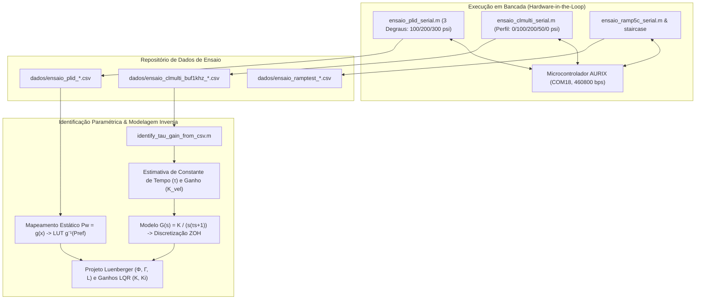

---
tags:
- bench-test
- aurix
- clmulti
- plid
- parameter-identification
- hil
title: Bench Testing & Identification
sources:
- title: Matlab2/RESUMO_CONTROLE_CLMULTI.md:1-57
  id: resumo
  resource: Matlab2/RESUMO_CONTROLE_CLMULTI.md
- resource: Matlab2/ensaio_clmulti_serial.m
  id: clmulti
  title: Matlab2/ensaio_clmulti_serial.m:1-100
- title: Matlab2/ensaio_plid_serial.m:1-100
  resource: Matlab2/ensaio_plid_serial.m
  id: plid
- id: tau-id
  title: Matlab2/identify_tau_gain_from_csv.m:1-120
  resource: Matlab2/identify_tau_gain_from_csv.m
description: Suíte de ensaios experimentais em bancada real (PLID, CLMULTI, CLSTEP,
  sweep de PWM e identificação de parâmetros).
generated_by: vio-wiki/deepseek-reasoner
status: stable
type: Module
generated:
  by: vio-companion/12.2.2
  at: '2026-10-19T18:43:46Z'
---

# Bench Testing & Identification

O diretório `Matlab2/` abriga os ensaios experimentais executados diretamente sobre a bancada física de testes automotiva via interface serial COM com o microcontrolador AURIX.[^resumo][^clmulti] 

## Principais Ensaios Experimentais

### 1. Ensaio PLID (*Plant IDentification* - `ensaio_plid_serial.m`)
- **Objetivo**: Mapear a relação hidromecânica entre a posição linear do pistão ($x$) e a pressão na pinça ($P_w$), obtendo os pontos de operação para calibração da tabela inversa $g^{-1}(P_{ref})$.[^resumo][^plid]
- **Funcionamento**: Aplica três degraus de pressão controlada (100, 200 e 300 psi) com rotina de homing intermediária.[^plid]
- **Descoberta física**: A planta apresenta histerese acentuada; a posição do pistão durante a subida (cruzamento) difere da posição de sustentação estável (*hold*), exigindo calibração refinada na região de alta pressão.[^resumo]

### 2. Ensaio CLMULTI (*Closed-Loop Multi-Reference* - `ensaio_clmulti_serial.m`)
- **Objetivo**: Avaliar a capacidade de rastreamento de trajetórias dinâmicas de pressão ADAS utilizando a estratégia indireta por posição.[^clmulti]
- **Perfil de Teste**: Sequência de patamares dinâmicos $0 \rightarrow 100 \rightarrow 200 \rightarrow 50 \rightarrow 0\,\text{psi}$ com comutações em 1s, 2s, 3s e 4s (ensaio com duração total de 6s).[^clmulti]
- **Aquisição**: Registra telemetria a 200 Hz via UART e drena um buffer interno de 1 kHz gravado na RAM do AURIX com precisão temporal de $1\,\text{ms}$.[^clmulti]

### 3. Outros Ensaios Disponíveis
- `ensaio_clstep_serial.m`: Resposta ao degrau simples em malha fechada.[^resumo]
- `ensaio_olstep_serial.m` e `ensaio_motor_ol_serial.m`: Ensaios em malha aberta para acionamento direto do motor LAC.[^tau-id]
- `ensaio_staircase_serial.m`: Varredura em escada para levantamento fino de não linearidades e perdas por atrito.
- `ensaio_ramp5c_serial.m`: Aplicação de rampas contínuas de pressão.

## Identificação Paramétrica do Atuador (`identify_tau_gain_from_csv.m`)

Para projetar formalmente o servossistema com integrador e o observador de Luenberger, desenvolveu-se o algoritmo de identificação em `identify_tau_gain_from_csv.m`.[^tau-id]

1. **Leitura e Filtragem**:
   - Detecta automaticamente o último arquivo CSV na pasta `dados/` ou recebe o caminho explícito.[^tau-id]
   - Isola janelas temporais onde o PWM aplicado é estável ($\text{movstd}(u) < 0.7$ e $u > 5\%$).[^tau-id]
2. **Cálculo da Velocidade**:
   - Aplica diferenciação numérica suavizada via filtro Savitzky-Golay na curva de posição $pos(t)$.[^tau-id]
3. **Ajuste Não Linear de Curva (Levenberg-Marquardt / Nelder-Mead)**:
   - Modela a resposta de velocidade do atuador como resposta ao degrau de primeira ordem:[^tau-id]
     $$v(t) = V_{ss} \left( 1 - e^{-t/\tau} \right)$$
   - Extrai por otimização (`fminsearch`) a constante de tempo do motor ($\tau$), a velocidade de regime ($V_{ss}$) e o ganho dinâmico:[^tau-id]
     $$K_{vel} = \frac{V_{ss}}{u_{loc}} \quad \left[\frac{\text{mm/s}}{\% \text{ PWM}}\right]$$
4. **Formulação do Modelo Contínuo**:
   $$G(s) = \frac{K_{vel}}{s(\tau s + 1)}$$
   Discretizado em ZOH com $T_s = 1\,\text{ms}$ para derivar as matrizes $(\Phi, \Gamma)$ do observador embarcado no AURIX.[^resumo]

## Conexões
- A teoria do servossistema com integrador associado está em [Control Strategy](../architecture/control-strategy.md).
- Os blocos de decodificação de telemetria serial estão em [Serial Communication & Codec](serial-interface.md).
- A metodologia e os resultados consolidados de validação estão em [Experimental Validation & Robustness](../architecture/experimental-validation.md).

[^resumo]: Matlab2/RESUMO_CONTROLE_CLMULTI.md:1-57
[^clmulti]: Matlab2/ensaio_clmulti_serial.m:1-100
[^plid]: Matlab2/ensaio_plid_serial.m:1-100
[^tau-id]: Matlab2/identify_tau_gain_from_csv.m:1-120
