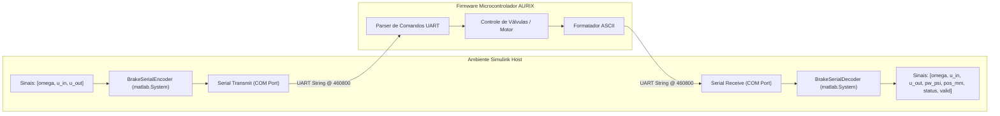

---
tags:
- matlab-system
- serial
- codec
- simulink
- uart
title: Serial Communication & Codec
description: Módulos MATLAB System Object para codificação e decodificação do protocolo
  UART do AURIX.
generated_by: vio-wiki/deepseek-reasoner
status: stable
type: Module
sources:
- id: encoder
  resource: Matlab2/BrakeSerialEncoder.m
  title: Matlab2/BrakeSerialEncoder.m:1-47
- title: Matlab2/BrakeSerialDecoder.m:1-64
  id: decoder
  resource: Matlab2/BrakeSerialDecoder.m
generated:
  by: vio-companion/12.2.2
  at: '2026-10-19T18:44:03Z'
---

# Serial Communication & Codec

Os arquivos `BrakeSerialDecoder.m` e `BrakeSerialEncoder.m` fornecem a ponte de dados e comunicação em tempo real entre os diagramas Simulink / rotinas MATLAB e o firmware embarcado no microcontrolador AURIX.[^encoder][^decoder]

## Arquitetura de Módulos (MATLAB System Objects)

Ambas as classes herdam de `matlab.System`, o que permite a compilação e execução direta dentro de blocos MATLAB System no Simulink com tipagem forte e tamanhos fixos pré-alocados.[^encoder][^decoder]

### 1. Codificador Serial (`BrakeSerialEncoder.m`)

O bloco é responsável por traduzir referências e comandos em sequências de bytes ASCII terminadas em `\n`.[^encoder]
- **Portas de Entrada**: `omega` (double), `uIn` (uint8: 0..100), `uOut` (uint8: 0..100).
- **Porta de Saída**: Vetor estático `msg` de `uint8` com comprimento máximo `MaxLength = 48` bytes e escalar `len` com os bytes válidos.[^encoder]
- **Propriedade `Mode`**:
  - `'ECHO'`: Formata a mensagem no padrão `[ECHO]<%.2f,%u,%u>\n`.[^encoder]
  - `'LIVE'`: Formata no padrão textual direto `OMEGA_P=%.2f,U_IN=%u,U_OUT=%u\n`.[^encoder]

### 2. Decodificador Serial (`BrakeSerialDecoder.m`)

Processa os fluxos recebidos pela porta serial e extrai de forma síncrona as variáveis de estado do atuador de freio.[^decoder]
- **Portas de Entrada**: Buffer `uint8` vindo do bloco *Serial Receive* e `count` (número de bytes válidos no ciclo de amostragem).[^decoder]
- **Portas de Saída**:
  1. `omega` (double): Rotação da bomba ou frequência de operação.
  2. `uIn` (uint8): Duty cycle da válvula de admissão (Apply / HSV).
  3. `uOut` (uint8): Duty cycle da válvula de descarga (Release / USV).
  4. `pwPsi` (double): Pressão hidráulica medida na pinça em psi.
  5. `posMm` (double): Deslocamento linear do pistão do atuador em milímetros.
  6. `status` (uint8): Flag de status da máquina de estados do firmware (ex: homing, pronto, erro).
  7. `valid` (logical): Sinal booleano que indica se o pacote continha cabeçalho válido (`[ECHO]` ou `[LIVE]`) e todos os 6 parâmetros numéricos foram parseados com sucesso.[^decoder]

## Funções de Suporte Legadas

No diretório `Matlab2/` também estão mantidas as funções procedurais puras:
- `brake_serial_encode.m`: Função direta para codificação de strings sem envolver a máquina de estados de `matlab.System`.
- `brake_serial_decode.m`: Função escalar que realiza varredura e extração rápida em linhas individuais de texto.

## Conexões
- A telemetria gerada alimenta as rotinas de teste descritas em [Bench Testing & Identification](matlab2-bench-tests.md).
- O fluxo geral de pacotes e cadência temporal está detalhado em [Data Flow & Telemetry](../architecture/data-flow.md).
- A integração com a arquitetura de hardware está descrita em [System Architecture](../architecture/system-architecture.md).

[^encoder]: Matlab2/BrakeSerialEncoder.m:1-47
[^decoder]: Matlab2/BrakeSerialDecoder.m:1-64
