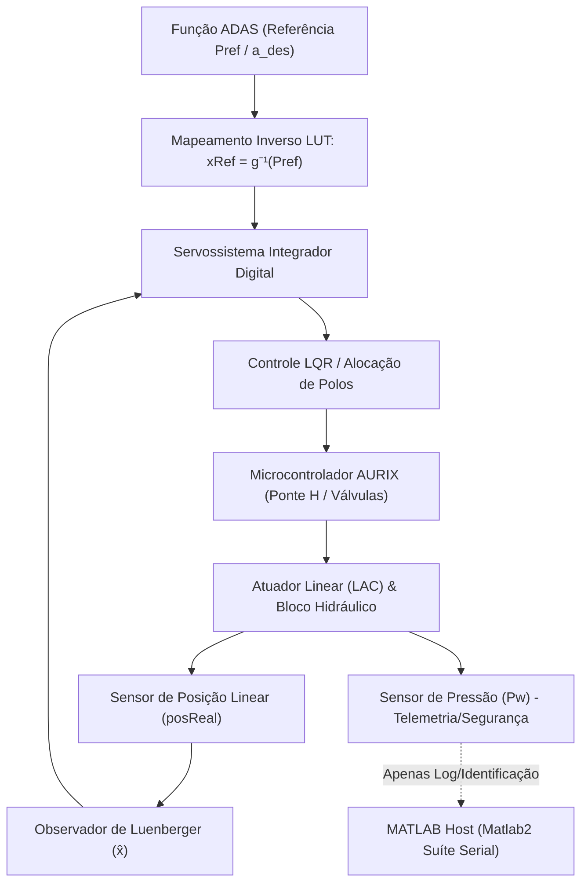

# Desenvolvimento de Controle de Módulo de Frenagem ADAS

O projeto **Desenvolvimento de Controle de Módulo de Frenagem ADAS** é uma pesquisa de Mestrado desenvolvida na **Escola Politécnica da USP** em parceria com a **Continental AG**.[^resumo] O objetivo central é o projeto, síntese, simulação numérica e validação experimental em bancada de leis de controle digital de pressão hidráulica para atuação em sistemas avançados de assistência ao condutor (ADAS - *Advanced Driver Assistance Systems*).

## Arquitetura e Organização do Repositório

O projeto é estruturado em duas vertentes complementares de engenharia e modelagem:

1. **Simulação e Modelagem Conceitual (`matlab/`)**:
   - Modelagem de planta hidráulica não-linear de dois volumes de pressão (`Psup` e `Pw`) através do modelo [Bloco_Hidraulico_2P](modules/matlab-simulation.md).[^bloco-2p]
   - Síntese de regulador ótimo linear quadrático com ação integral (LQI) e observador discreto de Luenberger via discretização ZOH a $100\,\mu\text{s}$ (`Ts = 1e-4`).[^lqi-run]
   - Análises automatizadas de sensibilidade paramétrica e robustez frente a perturbações em parâmetros fluidos e mecânicos (`beta`, `Vsup`, `Vw`, `Kb`, `Klb`, `Ain_max`).[^robustez]

2. **Ensaios Experimentais e Controle Físico em Bancada (`Matlab2/`)**:
   - Controle em tempo real com hardware microcontrolador Infineon AURIX conectado por porta serial UART a 460.800 bps.[^clmulti]
   - Princípio arquitetural fundamental: **A pressão não fecha malha diretamente no ensaio físico**; adota-se controle indireto por posição do atuador mecânico (LAC), com mapeamento estático/dinâmico $P_w = g(x)$ calibrado via ensaios PLID.[^resumo]
   - Rotinas de identificação de parâmetros do atuador elétrico ($\tau$ e $K_{vel}$) a partir de logs a 1 kHz.[^tau-id]
   - Decodificadores e codificadores de telemetria baseados em `matlab.System` ([BrakeSerialDecoder](modules/serial-interface.md) e [BrakeSerialEncoder](modules/serial-interface.md)).[^serial-codec]

## Estrutura da Wiki

- [System Architecture](architecture/system-architecture.md): Descrição detalhada da bancada, atuador linear (LAC), bloco de válvulas e interface com o microcontrolador AURIX.
- [Control Strategy](architecture/control-strategy.md): Análise comparativa entre o controle direto LQI de 2 pressões e a estratégia indireta por rastreamento de posição do LAC.
- [Data Flow & Telemetry](architecture/data-flow.md): Protocolos seriais ASCII de telemetria a 1 kHz, comandos de bancada e estrutura de buffers de dados.
- [Matlab Simulation & Synthesis](modules/matlab-simulation.md): Equações da planta hidráulica 2P, linearização analítica e síntese de ganhos de controle.
- [Bench Testing & Identification](modules/matlab2-bench-tests.md): Protocolos de ensaio experimental (PLID, CLMULTI, CLSTEP, RAMP) e extração de parâmetros dinâmicos.
- [Serial Communication & Codec](modules/serial-interface.md): Implementação dos blocos Simulink/MATLAB para decodificação de telemetria e injeção de comandos.
- [Experimental Validation & Robustness](architecture/experimental-validation.md): Metodologia de validação, tratamento de histerese e varredura de robustez paramétrica.

[^resumo]: Matlab2/RESUMO_CONTROLE_CLMULTI.md:1-57
[^bloco-2p]: matlab/Bloco_Hidraulico_2P.m:1-65
[^lqi-run]: matlab/script_controle_lqi_luenberger_run.m:1-100
[^robustez]: matlab/run_varredura_robustez_lqi_export.m:1-100
[^clmulti]: Matlab2/ensaio_clmulti_serial.m:1-100
[^tau-id]: Matlab2/identify_tau_gain_from_csv.m:1-120
[^serial-codec]: Matlab2/BrakeSerialDecoder.m:1-64
